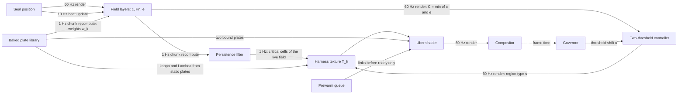
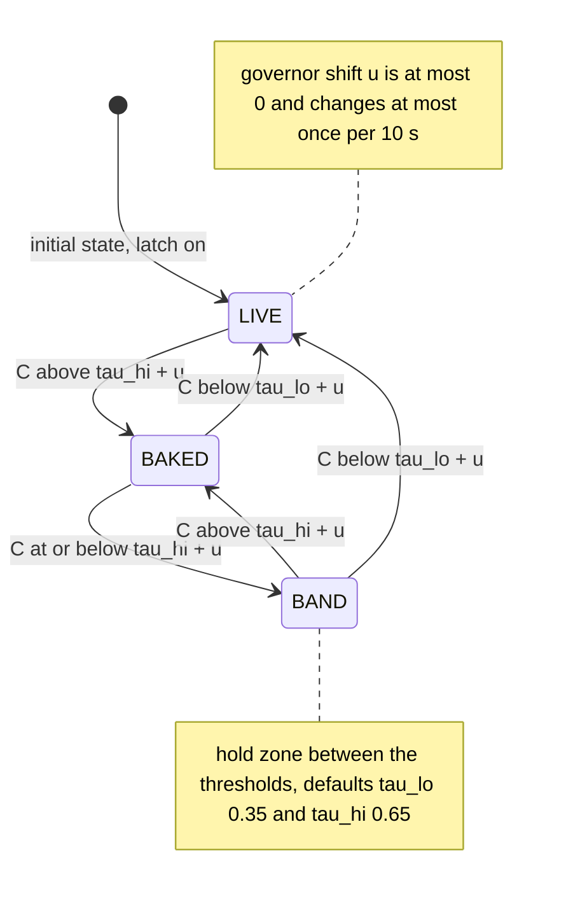
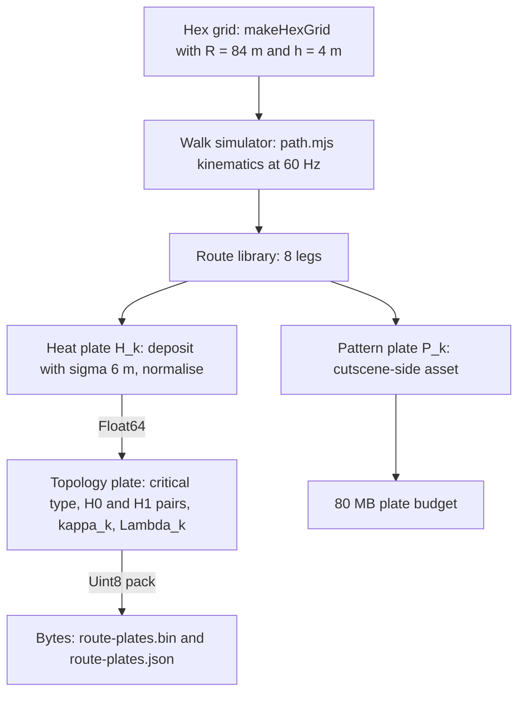
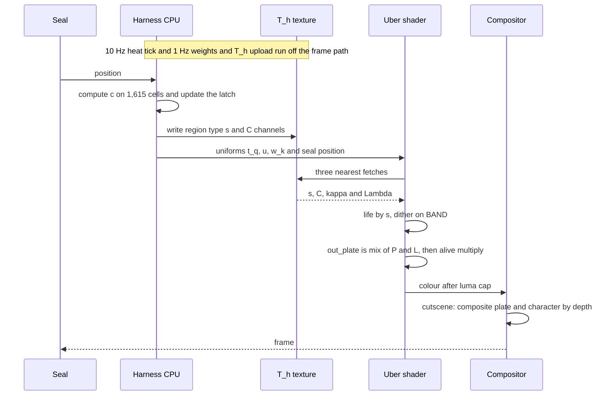
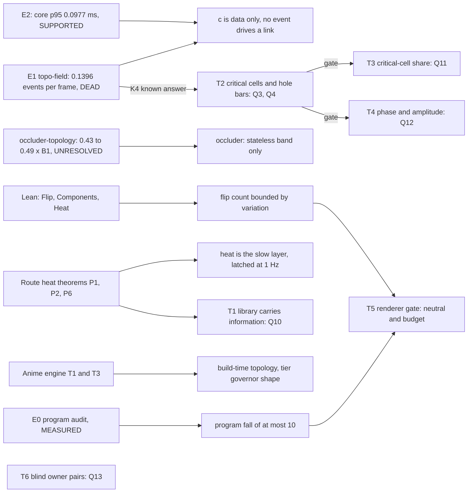

# Topological Shader: baked route heat, kept alive by topology

Technical report. Idea and harness concept: Teerth Sharma. Status: in development, design verified against the repository and formalised, nothing of the shader itself built.

## Abstract

The island's shading can be split into a baked part and a live part, with topology deciding which is which. The idea is to pre-bake the heat maps of the most obvious seal routes together with the pattern shader that follows them, to keep the baked picture alive through the topology of the heat field, and to run one shader type that combines route heat, the occluder field, the certainty field and a continuous-field projection under a single controller, the topological harness. This report states the design as a finite-state controller over a 1,615-cell hex grid, an uber shader whose per-pixel branch is a three-valued region type read from a 43 x 49 texture, and an offline baking pipeline for an 8-leg route library (182.2 m). It records the formal model (10 invariants, 13 propositions, three Lean files covering 4 of the 10 invariants, 2 of them fully), the program budget (a best-case fall of 10 programs against a bar of 10), five mechanisms for keeping baked shading alive, and six pre-registered tests T1 to T6 whose bars are fixed before any run. It also records the negative results the design is built around and the 20 corrections the repository forced on the first statement of the concept. The harness controller, the uber shader and the baked library are not built. Every design statement is a HYPOTHESIS until its test runs.

## Current condition (in development)

The experiments, the offline fields (hex grid, H0 persistence, hole labels, the certainty and heat fields), the Lean statements and the load-path engineering are built; the harness controller, the uber shader and the baked plate library are not.

State as of 2026-11-20

Status words: IMPLEMENTED (code or proof exists), SPECIFIED (written down with bars, no code), SUPPORTED and MEASURED (a number from a named run), UNTESTED, UNRESOLVED. "[S]" marks a scratch measurement made for this report (Node v25.8.1, one laptop, not committed).

| component | exists in the repo | evidence | status | next step |
|---|---|---|---|---|
| hex grid, 6-adjacency, disc | yes (experiment side) | `hexgrid.mjs`; chi = 1 [S] | IMPLEMENTED | production copy in `lib/world/heat/` |
| H0 persistence | yes | `topology.js:40` | IMPLEMENTED | none |
| holes by complement labels | yes | `cc.mjs:98-112`; K4 pass (`results.md:93`) | IMPLEMENTED (experiment) | none |
| H1 diagram by dual sweep, PL critical types | no | derivation in "What is formal" | SPECIFIED | T2 |
| certainty field c as an event economy | yes | E1 0.1396/frame | EXPERIMENT DONE NEGATIVE | used as data only |
| c cost | yes | E2 p95 0.0977 ms | SUPPORTED (Node) | none |
| route heat D5 scripts | no (not committed) | RR section 5 | numbers recorded, code lost | rewrite in T1 |
| occluder field D7 | yes (experiment) | 0.43-0.49 x B1, control 2.59x | EXPERIMENT DONE, UNRESOLVED | out of this machine (K11, K12) |
| latch D2 | yes (experiment) | `cc.mjs:116-129`; K7 pass | IMPLEMENTED (experiment) | add governor shift |
| Lean Flip, Components, Heat | yes | re-run: exit 0, no sorry | IMPLEMENTED | items 1-5 of the next Lean round |
| harness controller D1-D10 | no | "What is formal" | SPECIFIED | after T1, T2 |
| tier governor T3 | yes (anime engine) | `anime-engine.md:79-87`, synthetic traces | IMPLEMENTED, not wired to thresholds | wire after T5 |
| topological shader program | no | "Architecture" | SPECIFIED | T5 |
| route library L8 | computed | [S], `experiments/topological-shader/out/t1.md` | T1 DEAD: median X_A on roams 0.0185, margin -0.3208 | redesign needs a new pre-registration |
| route plate bake | no | "Architecture", Figure 3 | BLOCKED by T1 DEAD | not started |
| composer plate mode | yes | `post.js:346,531`, `framework.js:144` | IMPLEMENTED (cutscenes) | T6 bed |
| baked plate loader | no | `overview.md:285` | SPECIFIED (plan) | outside this report |
| stash protocol | yes, as data | `protocol.js`; engine note line 8 | IMPLEMENTED as contract, sampled by no player | treat as contract |
| topo pack on the real field (S1) | tools exist | `betti.js:144-148`, `kit.glsl.js:43` | UNTESTED; 2 of 3 named tools give false labels | rewrite the 2 helpers, then test labels |
| visitor routes | no | design spec line 21: 0 sessions | none | owner's logger decision |
| program audit | yes | `E0.md` Q3 | MEASURED | rerun at T5 in both contexts |

## The idea

Teerth Sharma's idea has three moves.

1. Pre-bake the heat maps of the ten most obvious routes of the seal, together with the pattern shader that follows each route, on top of a topological harness. The repository's own definition of "obvious" yields 8 routes, not 10 (section "The route library").
2. Keep the baked shading alive through topology. A baked picture is cheap and looks dead; topology says where the field can still change (critical cells, persistent features), so live work is spent only there and the plate stands elsewhere.
3. Build one topological shader type that combines route heat, the occluder field, the certainty field and the continuous-field projection under one harness. The harness is the controller the idea names: the only place where thresholds, the persistence filter, hysteresis and the frame-time governor live.

Stated exactly, a topological shader is one uber program whose per-pixel branch is selected by a region-type enum read from a small hex-grid texture. Baked plates carry the expensive pattern. A topology event here costs one texel write, not a program link or a batch rebuild, which is the move that separates the design from the dead E1 event economy. Topology keeps only the three jobs the thesis found alive (RT6): simplification baked at build, hysteresis decisions on slow fields, and stateless per-pixel response classes.

The continuous-field projection Pi_h(phi) is the piecewise-linear interpolant of a scalar field (heat, certainty, height, plate luma) sampled at the hex cell centres over the triangulated hex complex. In the shader it is three nearest-filtered fetches blended by barycentric weights, which is exact for the interpolant.

## Architecture

Figure 1 is the system map. Rates on the edges: 60 Hz render, 10 Hz heat update, 1 Hz chunk recompute.



Figure 1. System map. c is the certainty field, Hn the normalised heat, e the explained fraction, T_h the harness texture, kappa and Lambda the phase and amplitude fields.

Layers and rates, per cell v of the grid:

| layer | meaning | rate |
|---|---|---|
| c(v) | certainty, thesis D1 tested form, movers removed | 60 Hz on CPU (E2: core p95 0.0977 ms per frame with 20 movers) |
| Hn(v) | route heat D5 divided by its running maximum | deposit and decay at 10 Hz (`warmTick`, `Controller.jsx:101-104`) |
| e(v) | explained fraction of the heat by the library | 1 Hz |
| p | occluder persistence, screen side only, stateless (D7) | not part of this machine |

The harness is the only place that thresholds a field. It never selects programs after boot, never edits draw lists and never touches CAST, FX or GRADE. Movers leave the harness field: they are CAST.

### Harness controller

The controller is one per-cell latch with two thresholds and three region types. The control input is C = min(c, e). The type is LIVE while the latch is on, BAKED when the latch is off and C is above the high threshold, and BAND otherwise. The initial state is LIVE, which is today's picture.



Figure 2. Harness controller. The thresholds 0.35 and 0.65 are the thesis D2 defaults; the Hn-chunk thresholds 0.20 and 0.30 of the design spec are a separate pair and are not used by this latch. Over budget the governor lowers u, which shrinks the LIVE set.

### Offline baking pipeline

Topology is computed on floats before quantising, at zero runtime cost; T1 of the anime engine (`anime-engine.md:72-76`) is the precedent.



Figure 3. Offline baking. The generator is `scripts/bake-route-heat.mjs`. It imports production copies of `makeHexGrid`, `makeLabeler` and `h0Superlevel` (`lib/world/heat/`, per the design spec section 6) and a leg walker that copies the loop of `path.mjs:61-79` (acceleration, slow-down, 60 Hz).

Per leg k: the D5 deposit (sigma 6 m, cut 3.5 sigma, rho 1) runs along the walked leg with decay suspended (P9: monotone), is normalised to its maximum, in Float64. Topology on floats: critical type and multiplicity, H0 pairs of f and H1 pairs by the dual sweep, kappa_k and Lambda_k at delta 0.05. Quantise to Uint8 and pack per leg as H_k, crit, kappa_k, Lambda_k: 4 x 1,615 = 6,460 B. The 8 legs take 51,680 B on disk, and as RGBA8 43 x 49 GPU textures 8,428 B each, 67,424 B in total (84,280 B for the optional 10-leg set). The harness texture T_h is one more 8,428 B. The output carries the leg ids, lengths, deadlineS, grid fingerprint (R, h, n = 1,615) and the generator commit; a loader that sees another n refuses and stays ALL-LIVE. The pattern plates P_k are cutscene-side assets under `public/plates/` and count against the 80 MB plan budget (`baked-plan.md:11,113`); their resolution has no repository number and stays a free parameter of T6.

### One frame



Figure 4. One frame. The CPU writes the R and G channels of T_h every frame (thesis E2: core p95 0.0977 ms per frame with 20 movers, `results.md:182`); the GPU does the fetches, the branch on s, the dither and the alive multiply.

Runtime data flow by rate:

- 60 Hz (render): c on the 1,615 cells and the latch; three nearest fetches, branch on s, dither, alive multiply.
- 10 Hz (`warmTick`, `Controller.jsx:101-104`): heat deposit and decay on H.
- 1 Hz: Hn, the library weights w_k (8 dot products of length 1,615), e, R, the w_k latches, critical cells and kappa/Lambda of the live field if L1 is enabled, and the full T_h upload. One `h0Superlevel` sweep on a random 1,615-cell field takes a median 0.42 ms and p95 0.50 ms ([S], Node, 2,000 runs); two sweeps per second fit at 1 Hz but fail the design spec's 0.5 ms p95 per call if done in one call.
- Never: a program link, a define change or a draw-list edit after ready (C1, C6).

### The shader as a function

Per pixel x with world position p(x): cell v(x) and barycentric weights on the hex triangle containing p(x), s = s(v) and C = C(v) from T_h, and xi(x, t_q) a blue-noise or IGN hash in [0, 1) on stepped time t_q = floor(t fps)/fps (`protocol.js:4`).

```text
life(x, t) = 1 if s = LIVE;  0 if s = BAKED;  [xi(x, t_q) < 1 - C] if s = BAND
out_plate(x) = mix(P(x), L(x, t), life(x, t))
A(x, t) = 1 - a * (1 - life) * Lambda * (1/2 + 1/2 sin(2 pi kappa / delta - omega(Lambda) t_q)) * (1 - hero(x))
out(x) = lumaCap(out_plate(x) * A(x, t))
```

P is the baked pattern (the two bound route plates weighted by w, or the composer's plate in a held shot) and L the live pattern. The plate pass follows the WORLD contract (redrawn per shot in cutscenes, a material branch on the island). The alive pass follows the OCCLUDE contract: multiply, per frame, never on the hero seal (hero(x) = 1 on the seal's id in the alpha channel). omega(Lambda) = omega0 / (1 + Lambda), so large Lambda moves slowly; a is in [0, a_max], and omega0 and a_max are pre-registered in T6. kappa and Lambda come only from static plates. Because A is at most 1 the alive pass only darkens, which is what multiply can do; `lumaCap` is `protocol.js:88-93`. The see-through band of D7 is not in this function (correction K11).

### Off switch and failure modes

- `?topo=off` and the default build create no topological material at all (zero programs). `?topo=neutral` creates it with all latches on and a = 0 (I2), the ablation arm of every renderer test.
- Early session (M below 80): the persistence filter is not protected by P3, so the library weights are held at 0 (all LIVE) until M reaches 80.
- Grid fingerprint mismatch, context loss or a missing plate: ALL-LIVE, a = 0. Off-grid places (4 places, 5 clamped dock points have no cell): LIVE, today's shading.
- T0 and T1 have no engine preparation and no plate loader exists: ALL-LIVE, a = 0.
- Governor oscillation: each shift step adds its size to TV(u) in I6.
- Program growth: any program count above 109 (Intel) or 124 (RTX) at ready turns the flag off (C3).

The owner's rule that the island look is fixed stands: the island pass ships neutral behind a flag, and the first visible bed is one held cutscene shot (11 of 16 target docks hold the camera in every shot, `overview.md:276`).

### Evidence status



Figure 5. Evidence status. The first group is measured or proved work, the second the design constraints it settles, the third the six pre-registered tests that decide the open propositions. T6 is the decisive kill.

## What is formal

Labels as in the thesis: THEOREM (cited in `docs/research/2026-11-20-route-heat-chunking.md`, "RR"), DERIVED (proved or sketched here), HYPOTHESIS (untested, with its test), MEASURED (file or run named).

### Definitions

| id | definition |
|---|---|
| D1 grid | `makeHexGrid(84, 4)`: n = 1,615 cells, CSR adjacency, plus a cone vertex w adjacent to every border cell. Cells outside the disc have no cell; the shader treats them as LIVE |
| D2 layers | per cell v: c(v) in [0, 1], Hn(v) in [0, 1] (10 Hz), e(v) in [0, 1]; p for D7 is screen-side, stateless, not part of the machine |
| D3 control input | C(v) = min(c(v), e(v)) |
| D4 thresholds | tau_lo < tau_hi, gap g = tau_hi - tau_lo; defaults 0.35 and 0.65 (thesis D2) |
| D5 governor | a shift u_t <= 0, piecewise constant, changed at most once per 10 s (the T3 shape, `anime-engine.md:79-87`); effective thresholds (tau_lo + u_t, tau_hi + u_t); over budget lowers u (less LIVE) |
| D6 explained fraction | plates H_1..H_m (m = 8); w_k = clamp(<Hn, H_k> / <H_k, H_k>, 0, 1) at 1 Hz; S(v) = sum_k w_k H_k(v); R(v) = Hn(v) - min(Hn(v), S(v)); e(v) = 1 - R(v) / max(Hn(v), eps0), eps0 = 1/255 |
| D7 latch | l_t(v) = 1 (LIVE) if C_t < tau_lo + u_t; 0 if C_t > tau_hi + u_t; else l_{t-1}. Initial l_0 = 1 |
| D8 region type | LIVE if l_t = 1; BAKED if l_t = 0 and C_t > tau_hi + u_t; BAND otherwise. N = 3 |
| D9 output state | T_h, an RGBA8 texture of 43 x 49 texels: R = s and the critical type (2 + 2 bits, plus multiplicity), G = C, B = kappa, A = Lambda. Uniforms: t_q, u_t, w_1..w_m, seal position, the ids of the two bound plates |
| D10 plate pick | the top 2 of w_k, each held by its own two-threshold latch on w_k (thresholds pre-registered in T1's file) |

The 43 x 49 footprint is 43 columns and 49 rows, odd-r rows along z (`hexgrid.mjs:1-17`).

### Invariants

| invariant | holds by | machine-checked |
|---|---|---|
| I1 at most 1 program per pass, whatever N | the enum is data in T_h; no define depends on s | construction; program count MEASURED by T5 |
| I2 off switch: all l = 1 and amplitude a = 0 give out = L and multiply 1, so today's shading | mix(P, L, 1) = 0*P + L = L and x * 1.0 = x exactly in IEEE for finite inputs | construction; pixel identity MEASURED by T5 (the uber program may reorder float math, so the bar is <= 1/255, not bitwise) |
| I3 neutral bake: all BAKED, a = 0 gives out = P | mix(P, L, 0) = P exactly | construction |
| I4 a latch flips only after C crosses the whole gap | D7 | Flip.lean `step` models it (orientation mirrored: on at x >= hi, off at x <= lo, `Flip.lean:3-4`); D7's strict form is stronger |
| I5 flips(v) * g <= TV(C(v)) + g for fixed thresholds | P5 | YES: `flips_mul_le`, `flips_mul_le_of_stepBound` (re-run: exit 0, Lean 4.36.0) |
| I6 with the governor, flips(v) * g <= TV(C(v)) + TV(u) + g | P5 applied to C - u, and TV(C - u) <= TV(C) + TV(u) | NO (Lean round, item 1) |
| I7 lowering u never adds a LIVE cell: u' <= u pointwise gives l(u') <= l(u) at every t | induction on t: set needs C < tau_lo + u' <= tau_lo + u; a hold under u' cannot be a clear under u | NO (item 2) |
| I8 0 <= R <= Hn, e in [0, 1], e = 1 where Hn = 0 | D6 | NO (trivial; not listed) |
| I9 a stale plate cell is forgotten geometrically under the decayed update | one-step contraction | partly: `Heat.lean contraction` is one step; the n-step lambda^n form is an induction not written |
| I10 components of {f >= tau} map into components of {g >= tau - eps} when the sup distance of f and g is at most eps | interleaving | YES: `Components.lean interleave_*` |

### What the Lean files cover

Core Lean 4.36.0, no Mathlib, no `native_decide`; the three files re-run with exit 0 and no sorry.

| file | covers | invariant |
|---|---|---|
| `Flip.lean` | the latch step (`step`, orientation mirrored from D7) and the flip bound `flips_mul_le`, `flips_mul_le_of_stepBound` | I4 (the weaker, mirrored form), I5 (full) |
| `Components.lean` | the interleaving `interleave_*` of superlevel components under a sup-norm perturbation | I10 (full) |
| `Heat.lean` | `contraction` (one step of the decayed update) and `sharp_step` (a per-update change of H of at most K) | I9 (one step only); `sharp_step` is the input of Q7 |

Not covered by the three files: the D2 orientation and strict inequalities (only by a negation argument on paper); time-varying thresholds; the three-way BAND output; any count of events over many cells; P1 and P2 themselves (the diagram, the elder rule, `h0Superlevel`'s correctness); Lemma T; holes and duality; the normalisation Hn = H/M; kappa and Lambda.

Statements for the next Lean round (integer models in the style of `lean/TopologicalRendering/*.lean`):

1. Governor flip bound (I6): `flipsShift lo hi s xs us * (hi - lo).toNat <= tv xs + tv us + (hi - lo).toNat`, via `flips` on `xs - us` and `tv (xs - us) <= tv xs + tv us`.
2. Monotone shrink (I7): with the D7 orientation, for u' <= u pointwise and equal initial states, the state under u' implies the state under u at every index.
3. Local Lemma T on the 6-cycle: for every 6-bit neighbour mask m not 0 and not 63, the cyclic runs of ones equal the cyclic runs of zeros, and m is simple exactly when its complement is; finite, by `decide` over 64 cases.
4. Min is Lipschitz (the core of Q5): for lists a, b of equal length with |a_i - b_i| <= e, |minList a - minList b| <= e, and the same with a cap.
5. Normalised step (Q7): for 0 < M <= M', M' - M <= K, |H' - H| <= K, 0 <= H <= M: |H' * M - H * M'| <= 2 * K * M'.

### The hex complex and the derived facts

MEASURED [S]: R = 84 m gives V 1,615, E 4,698, F 3,084, chi = V - E + F = 1; R = 116 m gives 3,051 / 8,952 / 5,902, chi = 1. Every boundary vertex has exactly 2 boundary edges and the boundary vertices are exactly the 144 border cells (198 at R = 116 m), so the complex is a triangulated disc; coning it with one virtual vertex gives a 2-sphere in which every vertex has a cyclic link. On the triangular lattice one 6-adjacency serves a set and its complement, so there is no connectivity paradox, and `cc.mjs` `holeLabels` (`cc.mjs:98-112`) counts exactly the bounded complementary regions.

DERIVED, sketches not machine-checked:

- Lemma T as PL Morse theory. With the tie order of `topology.js:45`, U(v) is the set of link vertices above v and a(v) the number of maximal cyclic arcs of U(v): U empty is a maximum, U the whole link a minimum, a = 1 with U proper regular, a >= 2 a saddle of multiplicity a - 1. Banchoff on the coned sphere: maxima - sum of saddle multiplicities + minima (w included) = 2. Per-sample critical-cell counts at 1 Hz are a lower bound on event sites.
- Holes by duality. `h0Superlevel` pairs maxima with saddles (elder rule) and records no cycles (`topology.js:61`, `if (ra === rb) continue`). Running `h0Superlevel(-f')` on the coned graph with -f'(w) = +infinity makes the finite H0 bars the H1 bars [s, m] of the superlevel sets of f on the disc; a basin touching the border joins w at its own value with persistence 0.
- kappa bound. kappa(v) = min(2 delta, min over finite bars (b, d) of [min(|f(v) - b|, |f(v) - d|) + max(0, 2 delta - (b - d))]), the essential bar excluded. Under a sup distance of at most eps, |kappa_f(v) - kappa_g(v)| <= 4 eps, and across one edge |kappa(u) - kappa(v)| <= |f(u) - f(v)|. For a unit-height Gaussian (sigma 6 m, h 4 m) the along-gradient edge difference exceeds 0.05 for 0.45 m < d < 16 m from a peak, so the L2 kill is decided by how much of a plate lies within 16 m of dwell peaks of height near 1.
- Amplitude. tent(x) = max(0, min(x - d, b - x)) is 1-Lipschitz in x, b and d. Lambda(v) = max over bars with b - d >= delta of tent(f(v)) / N, with a fixed normaliser N (2 delta, or the essential range at bake time), moves at most 2 eps / N away from the delta threshold.
- Normalised heat speed. Hn = H/M with M the running maximum: |Hn' - Hn| <= 2K/M per update; with dt = 0.1 s at 10 Hz and rho K(0) = 1, K = 0.1, so eps_n <= 2/M per second. The design spec's constant 3 rho K(0)/M (spec line 103) uses the unsharpened 2 rho K(0). P3's margin needs delta > 2 eps_n = 4/M, that is M > 80 dwell-seconds at 1 Hz.

### Propositions

| id | statement | status |
|---|---|---|
| Q1 | diagrams of H0 and H1 move at most eps in bottleneck distance under a sup distance of at most eps | THEOREM (RR section 4, CEH; PL form, vines) |
| Q2 | merge trees are eps-interleaved | THEOREM (RR section 4, Morozov, Beketayev, Weber) |
| Q3 | critical cells = non-simple cells, classified by arcs of U(v); Banchoff sum = 2 on the cone | DERIVED, test T2 |
| Q4 | finite H0 bars of -f' on the coned graph are the hole bars of the superlevel sets of f | DERIVED sketch, test T2 |
| Q5 | kappa moves at most 4 eps; kappa differs across an edge by at most |f(u) - f(v)| | DERIVED |
| Q6 | top-tent Lambda moves at most 2 eps / N away from the delta threshold | DERIVED |
| Q7 | |Hn' - Hn| <= 2K/M per update | DERIVED |
| Q8 | I6 governor flip bound; I7 monotone shrink | DERIVED |
| Q9 | I2 and I3 exact neutral states | DERIVED for life in {0, 1} |
| Q10 | the 8 route plates explain the live heat of real or synthetic roams better than random legs or a uniform plate | HYPOTHESIS, T1 |
| Q11 | life near critical cells covers at most 10 percent of cells | HYPOTHESIS, T3 |
| Q12 | kappa phase on plates does not alias; Lambda predicts remaining life | HYPOTHESIS, T4 |
| Q13 | the topological arm reads as more alive than noise with the same budget | HYPOTHESIS, T6 |

## The route library

"Obvious" is defined from the place graph and the deadline queue. The place graph has 27 vertices (26 places plus the spawn statue); the weight of a directed leg a to b is `deadlineS` from a's dock point to b. A leg is obvious when the queue itself would prepare its target first: b has rank 1 in earliest-deadline order from a.

Definition: from spawn (0, 9), the legs to the 4 non-statue critical docks, then from each of those the leg to its rank-1 earliest-deadline dock outside the critical set. The critical set is excluded because it is already built before ready; with that exclusion, EDF rank 1 equals Euclidean nearest neighbour in all 4 cases (`path.mjs:29-51`, `deadline.js:12-15`). The 5 critical docks from spawn are spawn-seal 0.000 s, home 0.327, p-caustic 1.278, pr-tensorflow-124410 1.489 and p-resolvent 1.517 (`deadline.js:7`, `prewarm.js:17`, `places.js:297-298`). spawn-seal is the statue at spawn, a zero-length leg and not a plate; pr-openxla-46539 misses the critical set by 0.014 s (1.614). So the definition yields 4 real spawn legs and 8 legs in all, not 10.

| # | leg | length (dock point to dock point) | deadlineS |
|---|---|---|---|
| 1 | spawn -> home | 11.2 m | 0.327 s |
| 2 | spawn -> p-caustic | 31.5 m | 1.278 s |
| 3 | spawn -> pr-tensorflow-124410 | 28.7 m | 1.489 s |
| 4 | spawn -> p-resolvent | 33.7 m | 1.517 s |
| 5 | home -> pr-openxla-46539 | 21.0 m | 0.932 s |
| 6 | p-caustic -> pr-nemo-relay-481 | 18.6 m | 0.795 s |
| 7 | pr-tensorflow-124410 -> pr-openxla-46539 | 16.0 m | 0.383 s |
| 8 | p-resolvent -> pr-highway-3244 | 21.5 m | 1.005 s |

L8 totals 182.2 m. A secondary, non-gating L10 adds the rank-2 continuations of the two docks whose rank-1 target coincides: home -> pr-highway-3244 (1.589 s) and pr-tensorflow-124410 -> pr-highway-3244 (1.366 s). The tour of the topo-field bed (spawn, home, tf-124410, openxla, highway, aether, faraday, mujoco-3396, mujoco-warp-1541) shares only 2 of its first 8 legs with L8 (spawn-home and tf-124410-openxla), so the tour half of T1 is a weak check either way. With real routes the definition becomes the transition weight count(b within a window after a) / count(a) (Padmanabhan and Mogul, RR section 3, row 26); that needs sessions, and the design spec gates a baked prior at 100 while 0 exist.

The grid covers R = 84 m. 4 places lie beyond it (pr-polychrom-79 99.0 m, p-separatrix 93.9 m, pr-anyps5-12609 104.3 m, pr-tensorflow-128930 111.4 m) and one more dock point, p-epsilon-hollow, sits at 86.1 m; routes to them cannot be baked until the grid grows (3,051 cells at R = 116 m).

## Program budget

The island-static owner class holds 12 exclusive programs and 14 shared programs, on Intel and RTX (`E0.md:34,53,93`). The design has 2 programs (WORLD, OCCLUDE). The anime pattern is 2 programs per mesh family (surface and hull); programs in the anime engine's own context are outside `gl.info.programs` (`anime-engine.md:49`).

| configuration | net fall in programs | against the bar of 10 (HYPOTHESIS B, thesis line 321) |
|---|---|---|
| best case, 12 retire and 2 are added | 10 | exactly the bar, zero margin |
| with a hull | 9 | UNRESOLVED band |
| 3 enum variants per pass | 6 | below the bar |

The 14 shared programs do not retire. The ceilings at ready are 109 programs (Intel) and 124 (RTX). The lever is small to begin with: dock-only programs are 18 of 124 (14.5 percent, RTX) and 18 of 109 (16.5 percent, Intel), static-only 29 (23.4 to 26.6 percent). Variants stay off by default; the enum is data in T_h, so I1 holds whatever N is. Bakeability is per mesh and unmeasured: several static owners animate (Moat, MeltLake, Fountain, Highway, Triton, Rookery call `useFrame`).

## Keeping baked shading alive

Each row is HYPOTHESIS. Bars are fixed before any run. Control for all five: the same life budget placed without topology (uniform noise, plain thresholds, no persistence filter), judged by the owner in blind pairs on one held shot (T6). Before any constant is tuned, the ablation must show that amplitude 0 against a_max changes pixels inside the masked region.

| id | mechanism | invariant it rests on | offline test | kill number |
|---|---|---|---|---|
| L1 | live residual only within one ring of a surviving critical cell of Pi_h(f) with persistence >= 0.05; elsewhere the plate stands | Lemma T: flipping a simple cell cannot change the components of a level set | T3: share of cells per 1 Hz sample; the same field with cells permuted must give at least 3 times the share | PASS median share <= 0.10 on every roam and the tour; DEAD if median > 0.25 on any |
| L2 | phase 2 pi kappa / delta from the distance to the nearest critical value; motion bands are level sets that reconnect at saddles | critical values are diagram coordinates and move at most eps (P1); only values are used, never identities. Holds on static (baked) plates only (K15) | T4: known answer, kappa moves at most 4 eps per step or the run is void | DEAD if kappa differs by more than delta across more than 10 percent of edges of any plate |
| L3 | amplitude and tempo from the top tent of the persistence landscape (not the sum over bars); large Lambda moves large and slow, small flickers small | depends on the diagram and f(v) only; assumes persistence in value predicts lifetime in time | T4: Spearman correlation between Lambda at a cell and the remaining life of its {Hn >= 0.20} component (`diffComponents`) | DEAD if the correlation is below 0.3 on any roam |
| L4 | dither exactly in the hysteresis gap: BAND pixels take live with probability 1 - C, pattern held on stepped time so it does not boil | the latch's hold state; flips bounded by P5 (I5, Flip.lean) | T5: renderer, 3 runs per adapter | DEAD if a trace lasts more than 8 frames after its cause leaves in any of 3 runs (O3's criterion), or if BAND exceeds 0.25 of visible cells at defaults |
| L5 | stochastic re-bake: one plate cell per frame recomputed live and written back with probability proportional to R(v); a uniform sweep takes 1,615 / 60 = 26.9 s | the decayed update is a sup-norm contraction (P6; `Heat.lean contraction`); with decay suspended the field is monotone (P9) | T3: plate plus refresh on the walks, sup-norm staleness against the live field | DEAD if staleness >= 0.10 (the Hn gap tau_hi - tau_lo) on more than 1 percent of cell-seconds; DEAD on any build regression of longest frame or prewarm tick past the architecture-overview numbers |

For L2, the guarantee of 4 eps per step does not hold on the live field: in Hn units 4 eps_n <= 8/M, which is at least 0.0616 and above delta = 0.05 for every reachable M (M <= 129.8, P6), so the phase 2 pi kappa / delta can turn a full cycle per second there. The live-field phase is UNTESTED and unbounded by theory; kappa and Lambda come only from static plates.

Risks stated in advance: critical cells may cover the grid on a noisy field (L1); the phase may alias at h = 4 m (L2); identity is unstable (basins, elder swaps), so every mechanism uses diagram values only.

## Tests

Folder `experiments/topological-shader/` with README, PREREGISTRATION.md (a copy of these bars, never edited after the first run), code, `test/` and `out/`. Bars are fixed before any run. T2 is the gate for T3 and T4.

| test | input | bar | kill criterion | file |
|---|---|---|---|---|
| T1 RED first: does the library carry information? | `makeHexGrid(84, 4)`; `makePath(seed)` for seeds 1 to 30 (one shared tour, 30 roams); D5 at sigma 6 m, half-life 90 s, 10 Hz deposit, 1 Hz samples; arms A = L8, B = 8 random directed dock pairs (30 seeded draws), U = one uniform plate, C = the static layout prior, D = the first 8 legs walked (oracle) | PASS: tour X_A >= 0.5 and on the roams median(X_A - max(X_U, median X_B)) >= 0.15, with X = 1 - sum R / sum Hn as the median over 1 Hz samples | DEAD: that median <= 0.05, or median X_A < 0.2; anything else UNRESOLVED. Known answers or the run is void: a walk built only of L8 legs gives X >= 0.95; with the plate cells permuted it loses >= 0.2 | `library.mjs` |
| T2 topology correctness | 1,000 random fields plus 50 D5 snapshots | all exact: Banchoff sum = 2 on every field; finite H0 bars of f = maxima - 1; at 20 thresholds per field the dual-sweep hole count equals `holeLabels` (`cc.mjs:98`); K4 passes | KILL: any mismatch; holes are then dropped from the harness | `critical.mjs` |
| T3 critical-cell share and re-bake staleness | same bed as T1 | L1: median share <= 0.10 on every roam and the tour (control at least 3 times). L5: no bar beyond the kill | L1 DEAD if median > 0.25 on any. L5 DEAD if sup-norm staleness >= 0.10 on more than 1 percent of cell-seconds | `alive.mjs` |
| T4 phase and amplitude on the L8 plates | kappa and Lambda of the 8 plates, delta 0.05 | kill criteria only | L2 DEAD if |kappa(u) - kappa(v)| > delta on more than 10 percent of edges of any plate. L3 DEAD if Spearman < 0.3 on any roam | `phase.mjs` |
| T5 renderer gate | production build through `scripts/perf-frames.mjs`, 3 runs per adapter, adapters named; arms: flag off and `?topo=neutral` | neutral-vs-off pixel difference <= 1/255 per channel on 3 held frames; programs at ready <= 109 (Intel) and <= 124 (RTX); first-visit window >= 938 and >= 844 frames; longest prewarm tick <= 37 and <= 40 ms; first key-press frame <= 36.4 ms (thesis H3 row); BAND ghosting no trace longer than 8 frames in any of 3 runs; BAND <= 0.25 of visible cells | KILL: any one bar | `neutral.mjs` |
| T6 blind owner pairs, the decisive kill | one held cutscene shot, composer plate as P; arms: topological (section "The shader as a function") against uniform noise with the same life budget (equal share of animated pixels, same amplitude histogram). Precondition: a = 0 against a = a_max changes at least 1 percent of masked pixels by at least 2/255, else void; 8 pairs, order randomised | PASS: the owner picks the topological arm in >= 7 of 8 (null p = 9/256 = 0.035) | DEAD: <= 4 of 8; else UNRESOLVED | no file named; judged by the owner |

T1 states in advance that only 2 of the 8 library legs are tour legs, so the tour half is a weak check either way, and that the tour half is n = 1 because `tourOrder()` is deterministic (`path.mjs:29-51,82`): the seeds count only for the 60 s roam.

HYPOTHESIS S1 (pattern source): the topo pack holds 151 tools (`docs/shaders/topo.md:3`); swapping the kit's field helper for a sampler of T_h would make them draw the seal's real field. It is UNTESTED, and its kill must test labels, not compilation: `topoConnectedComponents` colours by distance to two hard-coded peaks (`betti.js:144-148`) and `tCrit` is a gradient-magnitude threshold that lights every flat region, including the cold Hn = 0 plateau (`kit.glsl.js:27-30,43`).

## What failed already

The design is built around these results, stated with their numbers and sources (TF: `experiments/topo-field/out/results.md`; OT: `experiments/occluder-topology/out/results.md`; RR: the route-heat research record; AR: `docs/architecture/overview.md`).

| result | number | source | consequence |
|---|---|---|---|
| the per-frame, mover-driven certainty field as an event economy is REFUTED (pre-registered DEAD) | 3,060 events over 21,921 frames = 0.1396 per frame; the faithful counter gives 1.941 events/s against 0.755 chunk crossings/s; with no movers the floor is 0.123 to 0.172 /s, 1.8 to 2.2 times the bar | TF, thesis | c is read as data only; no link, compile, batch rebuild or draw-list change on any c event; computing c is cheap (core p95 0.0977 ms, 0.2334 ms with events) |
| the occluder field is UNRESOLVED | 0.43 to 0.49 x B1; shuffled control 2.59x against a 20x bar; static occluders alone give 27, 29, 36 events against 35, 31, 40 with walkers, so the events come from camera motion | OT | only the stateless band survives; no event of p drives anything; the band is untested (O3) and its readback cost unmeasured (O1) |
| route heat misses the event bar although it is theorem-stable | 5.9 to 6.9 against 4.1 to 4.7 per minute, 1.4 to 1.5 times over; 32 of 35 events on seed 1 are deaths and splits; yet P6 moves at most 1 dwell-second per second, 8 to 20 times calmer than c | RR section 5 | heat is the slow layer, latched at 1 Hz; no claim of rarity is made |
| as a scheduler the heat prior gains nothing on a first visit | the 8 s horizon admits 27 of 27 docks from spawn; the first-visit prior is the static layout, whose nearest docks are the 5 critical docks the queue already puts first; 0 visitor sessions | RR section 2, design spec section 2 | the baked routes are shader inputs here, not a compile schedule; claims about real visitors are UNTESTED |
| the program-count lever is small | dock-only 18 of 124 (14.5 percent, RTX) and 18 of 109 (16.5 percent, Intel); static-only 29 (23.4 to 26.6 percent) | RR section 2, thesis | the family must be net zero or negative: at most 109 (Intel) and 124 (RTX) programs at ready |
| a layout-shaped field matches a route poorly | Jaccard overlap 0.423 at the end of a dock-seeking tour; 0.112 to 0.176 for wanderers; 0.113, 0.129, 0.032 after a 60 s roam | RR section 5 | no route library is trusted before T1 |
| baked plates are a plan, not built | `lib/anime/bake/` does not exist; the `plates` mode flag has no reader | AR sections 4, 5; `baked-plan.md` | the first test runs on what exists (the composer's live plate), not on a loader |

The heat field itself does not need baking (1,615 bytes, core p95 0.0977 ms). The bake pays only if the pattern is the expensive part, and that is unmeasured. The measured wins to date are load-path engineering and set the regression floor: curtain lift 13.5 to 11.7 s (Intel) and 13.8 to 11.7 s (RTX); RTX first-visit window 22 to 25 frames, then 844 to 999; first key-press frame 115 to 145 ms, then 24 to 36 ms; longest prewarm tick 89 to 92 ms, then 37 to 40 ms; FrameGuard 2209 of 2789 ms of the render loop (development build, one run) (AR 3.4, 3.5, 3.7). Every new program goes through the staggered prewarm queue and nothing links after ready.

## Corrections

The first statement of the concept was checked against the repository; 20 points changed. This is the honest record. Where the concept and the repository differ, the repository is right.

| # | the concept stated | the repository says, and the consequence |
|---|---|---|
| K1 | the library is "5 + 5"; 10 is twice a measured count | the 5 critical docks include spawn-seal, the statue at spawn (a zero-length leg); pr-openxla-46539 misses by 0.014 s (1.614). 4 real spawn legs; the definition yields 8 legs |
| K2 | the continuation is the earliest-deadline unvisited dock, "the nearest-neighbour continuation" of the tour | the tour orders by Euclidean dock-point distance, not by `deadlineS` (which subtracts radius + 7.9 m). Read literally, EDF from home picks tf-124410 (0.751 s) and from tf-124410 picks home (s = 0.000). Excluding the critical set, EDF rank 1 equals Euclidean NN in all 4 cases; the pre-registration fixes "exclude the critical set" |
| K3 | the tour's first legs are the library's by construction | 2 of the tour's first 8 legs are library legs (spawn-home, tf-124410-openxla); the tour half is not "PASS by construction" |
| K4 | three dock-seeking seeds as three samples | `tourOrder()` is deterministic; all seeds share one tour, only the 60 s roam differs; the tour half is n = 1 |
| K5 | deposit along the leg at 15 m/s | the walk accelerates (`accel` 2.6/s) and halves speed within 9 m of any place; the roam runs at 10 m/s (`path.mjs:12-19,70-71,88`; `motion.js:21-33`). Bake with the path.mjs kinematics |
| K6 | grid at R = 116 m about 3,080 cells | `makeHexGrid(116, 4)` gives 3,051 cells; estimate replaced by count |
| K7 | island-static is 12 exclusive programs: 12 to 1 is a fall of 11 | island-static is 12 exclusive and 14 shared; the design has 2 programs, so the best-case fall is 10, zero margin; with a hull 9; with 3 enum variants per pass 6. The 14 shared do not retire |
| K8 | island-static is the class to bake | several static owners animate; "static owner" is not "static look"; bakeability is per mesh, unmeasured |
| K9 | two passes in the stashes WORLD and OCCLUDE, on the island and in cutscenes | the stash protocol is data and CPU helpers; no WebGL2 player samples it. The island is the R3F renderer with no stashes. The real cutscene compositor is `post.js` (plate target plus character target, composited by depth in `satsuei`, `post.js:346,531-536`; `overview.md` 1.1, 1.2). "Stash" is a contract here; the island pass is a material change in R3F |
| K10 | life ("alive" motion) inside WORLD | WORLD is `when: "shot"`: compiled at build, redrawn only on a shot change. Compatible form: WORLD is the baked plate; life is a per-frame multiply in OCCLUDE, masked off the hero seal |
| K11 | the D7 classes (pup drawn over the occluder, see-through band) in OCCLUDE | OCCLUDE is multiply and never covers the hero seal; multiply only darkens and cannot reveal pup pixels lost to the depth test (`protocol.js:35-41`). D7 is incompatible with OCCLUDE; its home is the plate/character depth composite (`post.js:531-536`), the CAST side the harness never touches |
| K12 | the occluder classes map onto the same enum and the same state machine | D7's surviving form is stateless (the occluder test's own LEAD); the world enum is latched. Two enums; "one state machine" is false |
| K13 | e(v) = min(1, sum_k w_k H_k(v) / max(Hn(v), eps)) | where Hn = 0 and no plate covers v, e = 0, so every cold cell off the routes is LIVE, the opposite of the intent. Replaced by e(v) = 1 - R(v) / max(Hn(v), eps): e = 1 where there is no heat |
| K14 | eps is at most 1 dwell-second at 1 Hz (P6), used against delta = 0.05 | eps of P6 is in units of H; delta and kappa are in units of Hn = H/M. In Hn units eps_n <= 2/M per second (D10), and M <= 129.8 (P6) |
| K15 | kappa changes by at most 4 eps per step (L2) | the bound is right, but in Hn units 4 eps_n <= 8/M >= 0.0616 > delta = 0.05 for every reachable M. L2's guarantee holds only on static (baked) plates; live-field phase is UNTESTED |
| K16 | L3 amplitude: sum of tents over all bars over total persistence | a sum over bars and the total-persistence denominator are not bottleneck-stable. Replaced by the top tent, max over bars with persistence >= delta, over a fixed normaliser: 2 eps-stable (DERIVED) |
| K17 | S1: swap `tMorse` for a sampler of T_h and the pack draws the seal's real field | `topoConnectedComponents` colours by distance to two hard-coded peaks; `tCrit` lights every flat region. 2 of the 3 named tools would compile and lie; S1's kill tests labels, not compilation |
| K18 | critical classification reads Lemma T as PL Morse | true off the border. The CSR neighbour lists are sorted by id, not cyclic; 144 border cells have degree < 6 (`hexgrid.mjs:31,41`). Arcs need cyclic order, and the border needs the cone |
| K19 | T0 and T1 pin everything to BAKED | T0 and T1 have no engine preparation (cold path) and no plate loader exists (`overview.md:258-267,285`); the safe pin is ALL-LIVE with amplitude 0, today's picture |
| K20 | blind judge: at least 2 of 3 pairs | a fair coin passes 2 of 3 with probability 0.5. Replaced by 8 pairs, PASS at 7 (null p = 9/256 = 0.035) |

Verified as written, no change: the 43 x 49 texel footprint of the R = 84 m grid; 1,615 cells and 144 border cells; the 151 topo tools; `lib/anime/bake/` absent and the `plates` mode flag unread (`overview.md:266,285`); 11 of 16 target docks hold the camera; the 80 MB plate budget is a plan figure; the C1 to C6 numbers against the thesis ledger; delta 0.05 and the 10 Hz / 1 Hz cadence (design spec lines 39, 45); and the 4 places beyond 84 m up to 111.4 m.

## Limits

Every number cited comes from one laptop (Intel UHD and RTX 4060 Laptop, never compared), headless Chrome with 3 runs per arm, or single-thread Node. The [S] runs are scratch, uncommitted, one machine, and the `h0Superlevel` timing uses a random field, not a heat field. Lemma T's PL reading, the duality and the bounds on kappa, Lambda and the normalised heat speed are sketches until T2 and the Lean round check them. The route library is defined from geometry; no visitor route exists, so Q10 can only be tested on synthetic walks. The fill-rate cost of the uber branch on Intel UHD and the share of on-screen pixels that are BAKED in the follow camera are unmeasured; the LIVE disc of c alone has a radius of about 13.2 m and the BAND ring reaches about 16.8 m (smoothstep(6, 24, d) at 0.35 and 0.65, algebra), near the centre of the follow view. The owner's rule that the island look is fixed stands: the island pass ships neutral, and T6 runs on a cutscene shot. The occluder half rests on three unrun tests (O1, O3, O4) and an UNRESOLVED event result. Pattern-plate size is unknown. The research record has no source for a shader whose per-pixel branch is a persistence-latched region enum on a hex complex, but its search covered scheduling of compilation, not heat-driven shading: for the shading use the right word is unsearched, not novel.

## Where the evidence is

The evidence lives on the branch `exp/topology-field-and-load` at commit 4caf702. Repository paths in this document are relative to that branch. The main branch holds the documents only; the thesis is at `docs/thesis/topological-rendering.md` on main.

| key | path on the branch |
|---|---|
| RR | `docs/research/2026-11-20-route-heat-chunking.md` |
| design spec | `docs/design/2026-11-20-route-heat-chunking-design.md` |
| TF | `experiments/topo-field/out/results.md` |
| OT, OTP | `experiments/occluder-topology/out/results.md`, `experiments/occluder-topology/PREREGISTRATION.md` |
| AR | `docs/architecture/overview.md` |
| baked plan | `docs/backgrounds/baked-plan.md` |
| Lean | `lean/TopologicalRendering/` (`Flip.lean`, `Components.lean`, `Heat.lean`), `lean/README.md` |
| protocol, topology | `lib/anime/layers/protocol.js`, `lib/anime/topology.js` |
| shader packs | `docs/shaders/README.md`, `topo.md`, `occlude.md` |
| planned | `experiments/topological-shader/`, `lib/world/heat/`, `scripts/bake-route-heat.mjs` (none exists yet) |
